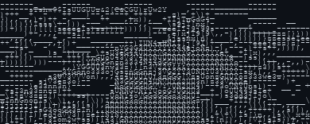

# README.md

  
  
  

<table border="0" cellspacing="0" cellpadding="0">
<tr>
<td width="55%" valign="top">

<pre><strong>$ less ~/workspace/profile/config.yaml</strong>

<strong>FOCUS:</strong>      "learning by building"
<strong>BUILDING:</strong>   "things at the HW/SW boundary"
<strong>EDUCATION:</strong> "ECE @ NIT Calicut"
<strong>INTERESTS:</strong>  ["VLSI", "CPU design", "Embedded Systems"]
<strong>HOBBIES:</strong>    ["badminton", "sketching"]
<strong>PHILOSOPHY:</strong> "learn, build, debug, repeat"
<strong>FUNFACT:</strong>   "one more project can't hurt :p"
</pre>

</td>
<td width="45%" align="center" valign="middle">

<strong>S I U U U U U U U U ⚽</strong>

</td>
</tr>
</table>

---

<h2><code>$ whoami -v</code></h2>

 

Hey, I'm Navaneet.

I'm an Electronics and Communication Engineering student at NIT Calicut who enjoys understanding how things work, from transistors and digital circuits to processors, embedded systems, and machine learning.

I like learning by building projects, breaking things, reading documentation, and figuring out why they broke in the first place.

**My key interests:**

- Digital systems, computer architecture, and CPU design
- Analog and digital VLSI
- RTL design, verification, and debugging
- Embedded systems, robotics, and IoT
- Machine learning and computer vision
- Semiconductors and hardware/software co-design

Currently exploring projects across hardware and software, one rabbit hole at a time.

---

### `$ ls -la ./tech-stack/`

  

  

  

---

<h2><code>$ git stats --all</code></h2>

 

<!-- Profile badges -->

  

<!-- GitHub trophies: compact single row -->

 

<!-- 3D contribution graph -->

 

<!-- Compact two-column statistics dashboard -->
<table width="100%" border="0" cellspacing="8" cellpadding="0">
<tr>
<td width="50%" align="center" valign="middle">

</td>
<td width="50%" align="center" valign="middle">

</td>
</tr>
<tr>
<td width="50%" align="center" valign="middle">

</td>
<td width="50%" align="center" valign="middle">

</td>
</tr>
</table>

<!-- Activity graph -->

---

### `$ ping social --all-interfaces`

---

### `$ sudo wisdom`

<picture>
  <source media="(prefers-color-scheme: dark)" srcset="https://github-readme-quotes-bay.vercel.app/quote?quoteCategory=motivational&theme=dark"/>
  
</picture>

---

### `$ tail -f /var/log/github-activity.log`

<picture>
  <source media="(prefers-color-scheme: dark)" srcset="https://raw.githubusercontent.com/nav-jk/nav-jk/output/github-snake-dark.svg"/>
  <source media="(prefers-color-scheme: light)" srcset="https://raw.githubusercontent.com/nav-jk/nav-jk/output/github-snake.svg"/>
  
</picture>

